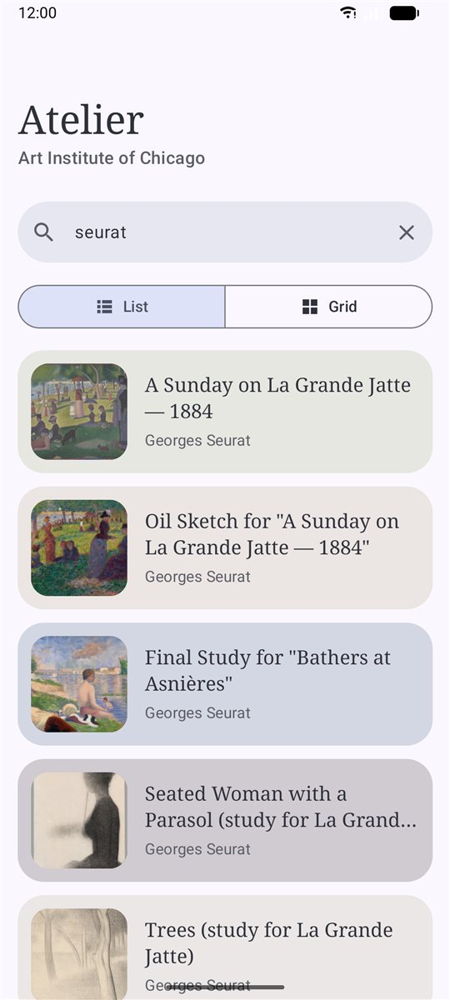
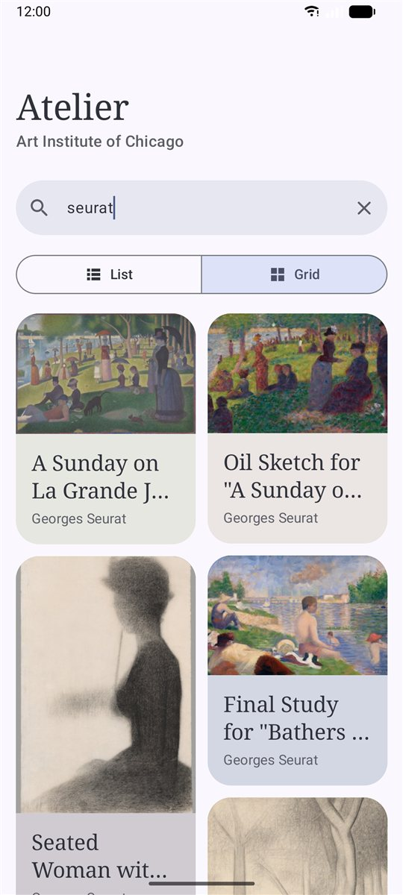
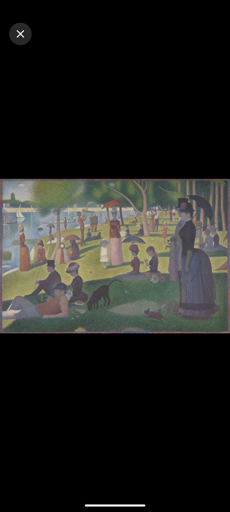
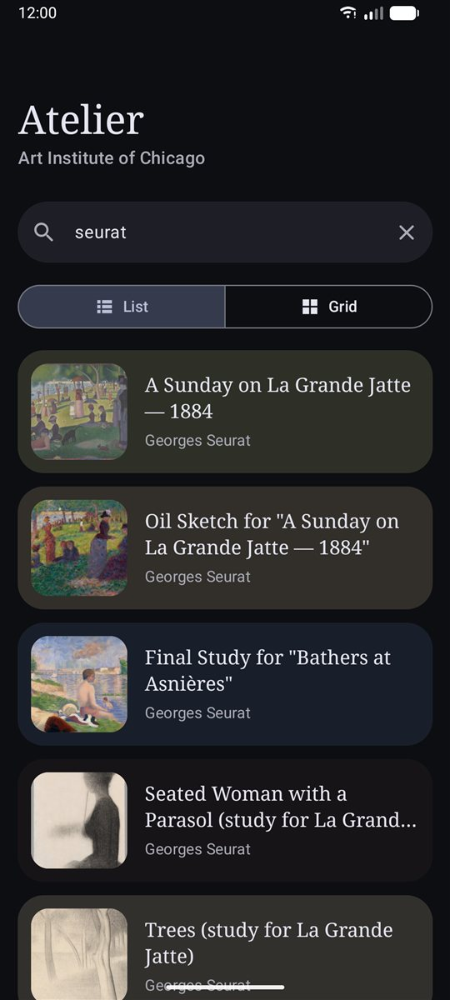

# Atelier

An Android app to search and browse the collection of the [Art Institute of Chicago](https://www.artic.edu), built as a technical test. It does what the brief asks (search, cancellation, detail, cache, tests, clear layers) and then puts real effort into how it looks and feels.

| Home | Search | Grid | Detail | Viewer | Dark |
|:---:|:---:|:---:|:---:|:---:|:---:|
|  |  |  |  |  |  |

## The brief, point by point

| Requirement | Where it lives |
|---|---|
| Search screen: text field and a list of results | `app/.../ui/search/SearchScreen.kt`, `ResultsList.kt` (the default) and `ResultsGrid.kt` (a visible List \| Grid switch) |
| A new search cancels the one in flight, stale results are never shown | `SearchViewModel` (`flatMapLatest`), proven by tests in `SearchViewModelTest`. See [Cancellation](#cancellation-and-concurrency) |
| Detail screen from an item, at least 3 fields | `app/.../ui/detail/DetailScreen.kt`: title, artist and up to seven more (date, medium, origin, dimensions, classification, style, public domain). Empty ones are hidden, and the fewest visible over 600 sampled artworks was 5 |
| Clear Data / Domain / Presentation separation | Separate Gradle modules, see [Architecture](#architecture) |
| UI in SwiftUI (the brief's iOS wording) | The Android equivalent: everything is Jetpack Compose, with no XML layouts and no Fragments |
| Search logic supports cancellation | Everything below the ViewModel is `suspend`, so cancelling reaches the OkHttp call |
| In-memory cache per query, 2 to 5 minutes | `TtlCache`, TTL of 3 minutes. See [Cache](#cache) |
| Valid entry: no network call. Expired: fetch and refresh | `ArtworkRepositoryCacheTest` |
| Domain tests with mocked repositories | `domain/src/test` (MockK) |
| Data tests for cache use and expiry | `data/src/test` (MockWebServer and a fake clock) |
| Presentation tests (optional, valued) | `app/src/test`: 73 tests with Turbine and `runTest` |
| Short README | You are reading it |

On "list": results open as a list, as the brief says. Because a museum is about the pictures, a clearly visible **List | Grid** switch sits under the search field. The grid keeps each artwork's aspect ratio, which a uniform list would crop. The choice is shared by the search and the "See all" screens and survives rotation.

### Where to look first

1. `app/.../ui/search/SearchViewModel.kt`: debounce, `flatMapLatest`, paging that cancels with the search.
2. `domain/.../usecase/SearchArtworksUseCase.kt`: the one real business rule.
3. `data/.../ArtworkRepositoryImpl.kt`: cache first, then network.
4. `data/.../cache/TtlCache.kt`: the cache itself.
5. `data/src/test/.../ArtworkRepositoryCacheTest.kt`: hit, expiry, per-query, errors.
6. `app/src/test/.../SearchViewModelTest.kt`: the ordering and cancellation tests.

Everything else (Home, "See all", the viewer, the design system) is extra and lives apart from these.

## The API

**[Art Institute of Chicago API](https://api.artic.edu/docs/)**, no key needed. It is public and stable, so anyone can clone and run the project. The content is visual, which suits an app where the UI matters. It returns presentation data the app uses (a tiny blurred placeholder, alt text and the dominant color of each artwork), and search is a real server-side query, so cancellation and per-query caching have something real to protect.

| Purpose | Request |
|---|---|
| Search | `GET /artworks/search?q=<query>&page=<p>&limit=20&fields=...` |
| Detail | `GET /artworks/{id}` |
| Museum highlights (Home) | `GET /artworks/search?query[term][is_boosted]=true&sort[boost_rank]=asc&limit=12&page=<p>` |
| Images | IIIF: `https://www.artic.edu/iiif/2/{image_id}/full/{width},/0/default.jpg` |

Quirks I found by probing it, and what the code does about them:

- **Rate limit of 60 requests per minute, and `Cache-Control: no-cache`** on every response. HTTP caching is useless, so the app has its own cache, and the Home's five shelves are cached to stay under the limit.
- **`total` is 133,287 for any query, gibberish included.** The only "no match" signal is `_score`: junk scores around 0.00002 and real matches 8 or more. The mapper drops anything under 0.01, which turns junk into a proper "no results" screen.
- **Relevant results run out long before the paging does** (for `monet` they are gone by page 5), and **paging past 1,000 results answers 403.** A page ends the list when it comes back short or with noise at its tail, and the repository never asks beyond page 50.
- **An empty query returns everything**, so the use case short-circuits it without touching the network.
- **Many fields can be null** (`image_id`, `artist_display`, ...), so the mapper is defensive.
- **The image server never upscales and only serves certain widths** (400, 600, 1200 and 1686 work; an arbitrary 300 came back empty). Requests are clamped to the original width and use those sizes.
- **It answers in English only**, so the UI is English only.

## How to run

Requirements: Android Studio (recent stable), JDK 17, an emulator or device with Android 8.0 (API 26) or newer, and internet access.

```bash
git clone https://github.com/Jorhetfield/Atelier.git
```

Open the folder in Android Studio, let Gradle sync and run the `app` configuration. From a terminal:

```bash
./gradlew :app:installDebug                                              # install on a device or emulator
./gradlew spotlessCheck :domain:test :data:test :app:testDebugUnitTest   # the checks CI runs
./gradlew spotlessApply                                                  # format
```

On Windows, if Gradle complains about the SDK, `local.properties` needs the path written as `sdk.dir=C\:/Users/<you>/AppData/Local/Android/Sdk`.

## Architecture

Four Gradle modules. The compiler, not discipline, enforces the boundaries.

```
              ┌──────────────┐
              │     :app     │  Presentation: screens, ViewModels, navigation, Hilt
              └──┬─────┬──┬──┘
                 │     │  └───────────────┐
                 ▼     ▼                  ▼
        ┌──────────┐  ┌────────┐   ┌───────────────┐
        │  :data   │─▶│:domain │   │ :designsystem │  theme + reusable components
        └──────────┘  └────────┘   └───────────────┘
        Retrofit, cache  pure Kotlin   Compose + Material 3 only
```

| Module | Knows about | Contains |
|---|---|---|
| `:domain` (Kotlin/JVM, no `android.*`) | nothing | `Artwork` models, `ArtworkRepository`, use cases, `ArtworkException` |
| `:data` (Kotlin/JVM) | `:domain` | Retrofit and OkHttp, DTOs, mapper, `ArtworkRepositoryImpl`, `TtlCache`. Everything is `internal` except one factory function |
| `:designsystem` (Android library) | Compose and Material 3 only | Theme, tokens and reusable components |
| `:app` | all of them | Screens, ViewModels, UI models, navigation, Hilt |

Why modules rather than packages: `:domain` cannot import Retrofit or Android even by accident, and `:app` cannot reach the DTOs because they are `internal` to `:data`.

- **Errors are domain exceptions** (`NetworkUnavailable`, `RateLimited`, `NotFound`, `ServerError`). The data layer translates HTTP and IO failures, and the ViewModel maps them to what the UI shows. I never wrap suspend calls in `runCatching`, because it would swallow `CancellationException`.
- **Use cases are thin on purpose.** `SearchArtworksUseCase` owns the one real rule (a blank query means no work); the others delegate, which gives the ViewModel a stable, mockable surface.
- **UI models are separate from domain models**, so the domain stays free of presentation details such as the image URL builder or the tint color.
- **Stateless `Content` composables** are separate from the entry points that touch ViewModels, so every screen can be previewed and screenshot-tested without Hilt.
- **Hilt and Navigation 3.** The repository is a singleton so the cache outlives screens and rotations.

## Cache

`data/.../cache/TtlCache.kt`, used by `ArtworkRepositoryImpl`.

- **Key**: the normalized query (`trim` and lowercase), so `"Monet"`, `" monet "` and `"MONET"` share one entry. Every page of a query is its own entry.
- **TTL**: 3 minutes, inside the 2 to 5 required. A collection barely changes, and 3 minutes covers a browsing session without hiding anything for long.
- **Valid hit**: returned immediately, **no network call**. **Expired or missing**: fetch, store, return. Expiry is checked on read and expired entries are purged on write.
- **Injectable clock** (`kotlin.time.TimeSource`): tests move time forward with `TestTimeSource`, with no real delays.
- **Thread safety**: a `Mutex` guards the map, and the lock is **never held during the network call**, otherwise one slow request would block every other lookup.
- **Failures and cancellations are never cached.**
- Searches and highlights also feed an artwork-by-id cache, so opening an item from a list needs no extra request.

Deliberate non-feature: two identical requests at the same moment are not merged. Sharing an in-flight request is a nice optimization, but it couples callers (cancelling one search would cancel the other), and I preferred simple, predictable cancellation.

## Cancellation and concurrency

```
query → debounce(300 ms) → trim → distinctUntilChanged → flatMapLatest { search }
```

- `flatMapLatest` cancels the previous search the moment a new term arrives, so a slow search A **cannot** overwrite a later search B. A test makes A slower than B and checks the final state is B.
- Everything below is `suspend` (ViewModel, use case, repository, Retrofit), and Retrofit's suspend support cancels the underlying OkHttp call, so the request is aborted and not just ignored.
- `CancellationException` is rethrown first in the error translation and is never turned into an error state.
- **The state always reflects the current query.** While a new search loads, nothing of the previous one stays on screen, and a failed or empty search never shows older results. An earlier version kept the last results blurred behind the loader; I removed it because it was the one place where the brief's "results of previous searches must not be shown" could be read as broken.
- **Paging follows the same rule.** `loadMore()` runs as its own job, cancelled when a new search begins, and a page only lands if its term is still the one on screen. A page already on its way is never requested twice, and a failed page keeps what is shown and retries the same page.
- Pressing the keyboard's search key or retry bypasses the debounce through a `Channel(CONFLATED)`, so those events are never lost or duplicated.
- The text field keeps its own text. Reading it back through the ViewModel's flows delayed it by a frame, and when several characters arrived at once (paste, dictation) the field dropped or reordered letters.
- On the Home, each shelf loads in its own coroutine, so a slow or failing shelf never blocks the others.

## Testing

**130 unit tests** and 70 screenshot references.

| Layer | Tests | Approach |
|---|---|---|
| `:domain` | 14 | Use cases against a **mocked** `ArtworkRepository` (MockK), including "failures reach the caller unchanged" and "cancellation is not swallowed" |
| `:data` | 43 | `MockWebServer` plus a fake clock: cache hit makes no request, expiry refetches, the TTL boundary, per-query and per-page caching, normalization, errors not cached, error mapping, cancellation, the end-of-results rules |
| `:app` | 73 | ViewModels with a fake repository, a test dispatcher, `runTest` and Turbine: ordering (slow A never overwrites B), debounce, retry, paging, the shelf screen, the detail loading rules and the pure zoom math |

JUnit 6 is used throughout. I checked that the tests can fail by temporarily breaking the code (removing expiry, caching errors, replacing `flatMapLatest` with `flatMapMerge`, dropping the cancellation of a page, and so on) and confirming a test went red each time.

CI (GitHub Actions) runs Spotless and the unit tests on every push and pull request.

**Screenshot tests.** The design system and every screen are covered by Compose Preview Screenshot Testing (`./gradlew :app:testDebugScreenshotTestDefaultTestSuite` to compare, `:app:updateDebugScreenshotTestDefaultTestSuite` to record). Honestly:

- The engine is still **alpha** (`0.0.1-alpha17`). It is the one pre-release dependency I accepted, because it is Google's own tooling, and it sits behind two experimental flags in `gradle.properties`.
- The references were recorded on Windows and rendering differs slightly across systems, so these tests **do not run in CI**.
- They live in `:app` because the engine cannot resolve resource classes inside a library module.

## Beyond the brief

None of this was asked for, and each piece stays apart from the required ones.

- **A design system module** (`:designsystem`): theme (Material 3 Expressive, dynamic color with a warm fallback palette, serif headings), tokens and every reusable component, each with previews. It depends only on Compose and Material 3. Material 3 is pinned to `1.5.0-rc01`, above the Compose BOM, because most Expressive APIs are stable there, and all motion goes through `MaterialTheme.motionScheme`.
- **A Home of curated shelves** (museum highlights by the museum's own ranking, then Monet, Van Gogh, Picasso and Japanese prints) in Material 3 carousels. A failed shelf hides itself, and only if all fail does the screen show an error. Each shelf has a **See all** action that opens its full list with the same infinite scroll as the search.
- **Detail screen** with a parallax hero, a background tinted with the artwork's dominant color, and a **full artwork viewer** (pinch zoom 1x to 5x, double tap, drag clamped to the edges). I wrote the gesture math myself (`ZoomMath.kt`, 9 unit tests) because the library options are pre-1.0.
- **Image loading** with Coil 3: the blurred placeholder first, then a crossfade, and the API's alt text as the content description.
- I first built a shared-element transition from card to hero and **removed it**: with a full-bleed hero it no longer fit, and it glitched with the predictive back gesture.

## Known limitations and what I would do next

- Paging stops at 1,000 results, which is all the API exposes for a query. In practice the relevant results of most queries end much sooner.
- Identical in-flight requests are not shared (see [Cache](#cache)). A shared deferred with reference counting would remove the duplicates without coupling cancellation.
- English only, because the API is.
- The viewer uses a single large image, not IIIF tiles, which would give real detail at 5x on large paintings.
- The tablet layout adapts but is not tuned; a list-detail layout would read better on wide screens.
- The launcher icon is the default one.

## Stack

Kotlin 2.4, Gradle 9.6, AGP 9.5, JDK 17, minSdk 26, target and compile SDK 37. Jetpack Compose (BOM 2026.09.00) with Material 3 `1.5.0-rc01`, Navigation 3, Hilt with KSP, Retrofit 3, OkHttp 5, kotlinx.serialization, Coil 3, coroutines and Flow. Tests with JUnit 6, MockK, Turbine, MockWebServer and Compose Preview Screenshot Testing. Spotless with ktlint.

## Credits

Data and images courtesy of the [Art Institute of Chicago](https://www.artic.edu) and its public API. Works marked as public domain are available under CC0, and the app shows that flag on the detail screen. Atelier is an independent project and is not affiliated with the museum.
