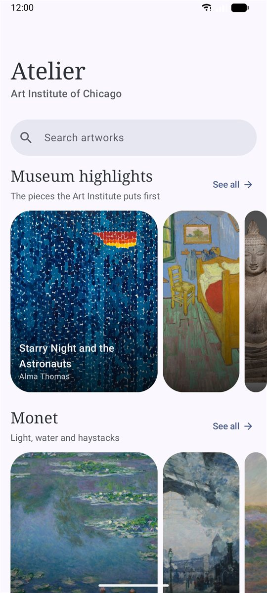
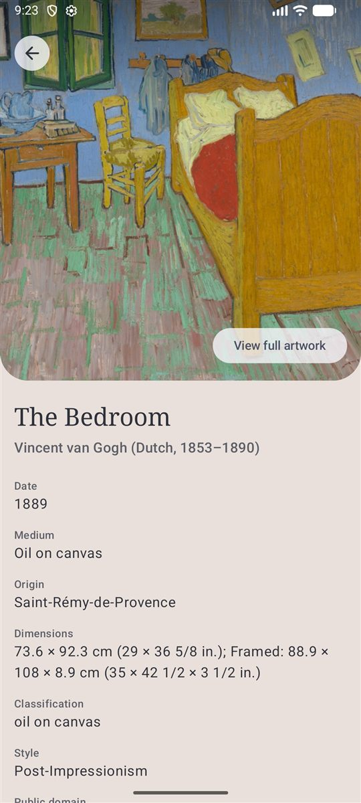

# Atelier

An Android app to search and browse the collection of the [Art Institute of Chicago](https://www.artic.edu), built as a technical test. The brief asks for a simple search and detail app that shows good practice in architecture, concurrency, caching and testing. Atelier does that first, and then puts real effort into how it looks and feels.

| Home | Search | Detail | Full artwork viewer |
|:---:|:---:|:---:|:---:|
|  |  |  |  |

Dark theme and dynamic color work too:


---

## Contents

1. [The brief, point by point](#1-the-brief-point-by-point)
2. [The API](#2-the-api)
3. [How to run](#3-how-to-run)
4. [Architecture](#4-architecture)
5. [Cache](#5-cache)
6. [Cancellation and concurrency](#6-cancellation-and-concurrency)
7. [Testing](#7-testing)
8. [Beyond the brief](#8-beyond-the-brief)
9. [Known limitations and what I would do next](#9-known-limitations-and-what-i-would-do-next)
10. [Stack](#10-stack)

---

## 1. The brief, point by point

| Requirement | Where it lives |
|---|---|
| Search screen: text field and a list of results | `app/.../ui/search/SearchScreen.kt`, `ResultsGrid.kt` |
| A new search cancels the one in flight, stale results never shown | `SearchViewModel` (`flatMapLatest`), proven by a dedicated test, see [section 6](#6-cancellation-and-concurrency) |
| Detail screen opened from an item, at least 3 fields | `app/.../ui/detail/DetailScreen.kt`: title, artist, date, medium, origin, dimensions, classification, style and the public-domain flag (up to 9 fields; empty ones are hidden, and the fewest visible on 600 sampled artworks was 5) |
| Clear Data / Domain / Presentation separation | Three Gradle modules, plus a design system module. [Section 4](#4-architecture) |
| All UI in Compose | Yes, no XML layouts and no Fragments |
| Search logic supports cancellation | Everything below the ViewModel is `suspend`, so cancelling reaches OkHttp |
| In-memory cache per query, 2 to 5 minutes | `TtlCache`, TTL of 3 minutes. [Section 5](#5-cache) |
| Valid entry: no network call. Expired: fetch and refresh | `ArtworkRepositoryCacheTest` |
| Domain tests with mocked repositories | `domain/src/test`, MockK |
| Data tests for cache use and expiry | `data/src/test`, MockWebServer and a fake clock |
| Presentation tests (optional, valued) | `app/src/test`: 46 tests with Turbine and `runTest` |
| Short README | You are reading it |

One honest note: the brief says "list". Results are shown in an adaptive staggered grid because artworks have wildly different aspect ratios and a uniform list would crop or letterbox most of them. It is still a lazily composed list of items that opens a detail on tap.

---

## 2. The API

**[Art Institute of Chicago API](https://api.artic.edu/docs/)**, no key needed.

Why this one:

- It is public, stable and free of authentication, so anyone can clone and run the project.
- The content is visual. For an app where I wanted the UI to matter, a museum is a much better source than a list of JSON records.
- It returns useful presentation data: a tiny blurred placeholder (`thumbnail.lqip`), alt text, and the **dominant color** of each artwork. The app uses all three.
- Search is a real server-side query, so cancellation and per-query caching have something real to protect.

Endpoints used:

| Purpose | Request |
|---|---|
| Search | `GET /artworks/search?q=<query>&page=<p>&limit=<n>&fields=...` |
| Detail | `GET /artworks/{id}` |
| Museum highlights (Home) | `GET /artworks/search?query[term][is_boosted]=true&sort[boost_rank]=asc&limit=12` |
| Images | IIIF: `https://www.artic.edu/iiif/2/{image_id}/full/{width},/0/default.jpg` |

### Quirks I found by probing it (and how the app deals with them)

| Finding | Consequence |
|---|---|
| Rate limit of 60 requests per minute per IP | The Home loads 5 shelves at launch; all are cached, so staying under the limit is easy |
| `Cache-Control: no-cache, private` on every response | HTTP caching is useless, so the app needs its own cache |
| `total` is 133,287 for any query, including gibberish | The count cannot tell "no results" apart from results |
| Gibberish still returns 200 with junk, but with a `_score` around 0.00002; real matches score 8 or more | The mapper drops results with `_score` below 0.01. That is the only reliable "no results" signal |
| Relevant results run out long before the paging does: for `monet` the matches are gone by page 5, while `total_pages` still says 6,665 | A page ends the list when it comes back short or with noise at its tail, because results arrive ranked and the noise always follows the matches |
| Paging past 1,000 results (page 50 at 20 per page) answers 403 | The repository never asks beyond page 50 and reports that page as the last |
| An empty `q` returns everything | The use case short-circuits blank queries without touching the network |
| Highlights responses carry no `_score` | The highlights mapper deliberately skips the relevance filter |
| Several fields (`image_id`, `artist_display`, ...) can be null | The mapper is defensive; an artwork without a picture is still a valid item |
| The image server never upscales | Requests are clamped to the original width (`thumbnail.width`), see `ArtworkImageUi.url` |
| `Accept-Language` and `?lang=` are ignored | Data is English only, so the UI is English only too |
| Error body is `{"status","error","detail"}`; 404 unknown id, 400 malformed id, 403 for oversized `limit` | Mapped to typed domain exceptions |

---

## 3. How to run

Requirements: Android Studio (recent stable), JDK 17, an emulator or device with Android 8.0 (API 26) or newer, and internet access.

```bash
git clone https://github.com/Jorhetfield/Atelier.git
```

Open the folder in Android Studio, let Gradle sync, and run the `app` configuration. Or from a terminal:

```bash
./gradlew :app:installDebug
```

Checks (the same ones CI runs):

```bash
./gradlew spotlessCheck :domain:test :data:test :app:testDebugUnitTest
```

Format the code:

```bash
./gradlew spotlessApply
```

Screenshot tests (not part of CI, see [section 7](#7-testing)):

```bash
./gradlew :app:testDebugScreenshotTestDefaultTestSuite          # compare
./gradlew :app:updateDebugScreenshotTestDefaultTestSuite         # record
```

On Windows, if Gradle or lint complain about the SDK, `local.properties` needs the path written as `sdk.dir=C\:/Users/<you>/AppData/Local/Android/Sdk`.

---

## 4. Architecture

Four Gradle modules. The compiler, not discipline, enforces the boundaries.

```
              ┌──────────────┐
              │     :app     │  Presentation: screens, ViewModels, navigation, Hilt
              └──┬─────┬──┬──┘
                 │     │  └───────────────┐
                 ▼     ▼                  ▼
        ┌──────────┐  ┌────────┐   ┌───────────────┐
        │  :data   │─▶│:domain │   │ :designsystem │  theme + reusable components
        └──────────┘  └────────┘   └───────────────┘
        Retrofit, cache  pure Kotlin   Compose + Material 3 only
```

| Module | Type | Knows about | Contains |
|---|---|---|---|
| `:domain` | Kotlin/JVM, no `android.*` | nothing | `Artwork` models, `ArtworkRepository` interface, use cases, `ArtworkException` |
| `:data` | Kotlin/JVM | `:domain` | Retrofit and OkHttp, DTOs, mapper, `ArtworkRepositoryImpl`, `TtlCache`. Everything is `internal` except one factory function, `createArtworkRepository()` |
| `:designsystem` | Android library | Compose and Material 3 only | Theme, tokens, reusable components |
| `:app` | Android application | all of the above | Screens, ViewModels, UI models, navigation, DI |

Why modules rather than packages: `:domain` cannot import Retrofit or Android even by accident, and `:app` cannot reach the DTOs because they are `internal` to `:data`. The design system cannot depend on `:domain`, so components stay generic (for example `ArtworkCard` receives its image as a composable slot instead of knowing about Coil).

Decisions worth defending:

- **Errors are domain exceptions** (`NetworkUnavailable`, `RateLimited`, `NotFound`, `ServerError`), thrown by the repository. The data layer translates HTTP and IO failures; the ViewModel maps them to an `ErrorKind` for the UI. I never wrap suspend calls in `runCatching`, because it would swallow `CancellationException`.
- **Use cases** are thin on purpose. `SearchArtworksUseCase` owns the one real business rule (blank query means no work), the others delegate. They give the ViewModel a stable, mockable surface.
- **UI models are separate from domain models** (`ArtworkUi`, plus a mapper). The domain stays free of presentation concerns such as the IIIF URL builder or the tint color.
- **Stateless `Content` composables** are separated from the entry points that touch ViewModels, so every screen can be previewed and screenshot-tested without Hilt.
- **Hilt** wires it up. The repository is a singleton so the cache outlives screens and configuration changes.
- **Navigation 3** with a type-safe back stack of `NavKey`s.

---

## 5. Cache

Implemented in `data/.../cache/TtlCache.kt` and used by `ArtworkRepositoryImpl`.

- **Key**: the normalized query (`trim` + lowercase), so `"Monet"`, `" monet "` and `"MONET"` share one entry.
- **Entry**: the value plus the instant it was stored.
- **TTL**: 3 minutes, inside the 2 to 5 required. A museum collection barely changes, and 3 minutes covers a typical browsing session without hiding anything for long.
- **Valid hit**: returned immediately, **no network call**.
- **Expired or missing**: fetch, store, return. Expiry is checked on read, and expired entries are purged on write so the map does not grow forever.
- **Injectable clock**: `kotlin.time.TimeSource`. Tests use `TestTimeSource` and move time forward manually, so there are no real delays.
- **Thread safety**: a `Mutex` guards the map. The lock is **never held during the network call**, otherwise one slow request would block every other lookup.
- **Failures are never cached**, and neither is cancellation.
- **Paging**: every page of a query is its own entry, so scrolling back never repeats a request and each page expires on its own clock.

There are three small caches behind the one repository:

| Cache | Key | Fed by |
|---|---|---|
| Search | normalized query **and page** | search results, one entry per page |
| Artwork by id | id | search results and highlights, so opening an item from a list needs no extra request |
| Highlights | none | the highlights request |

A detail screen therefore usually opens instantly from cache. If it does not (a direct id, or an expired entry), `getArtwork(id)` falls back to `/artworks/{id}`.

**Deliberate non-feature**: two identical requests at the same moment are not merged into one. Sharing an in-flight request is a nice optimization, but it couples callers: cancelling the first search would cancel the second. I preferred simple, predictable cancellation. It is listed under next steps.

---

## 6. Cancellation and concurrency

The pipeline in `SearchViewModel`:

```
query (StateFlow)
  → debounce(300 ms)
  → trim
  → distinctUntilChanged
  → flatMapLatest { search }   // starting a new search cancels the previous one
```

- `flatMapLatest` cancels the previous collector as soon as a new query arrives, so a slow search A **cannot** overwrite a later search B. A dedicated test proves it: A is made slower than B, and the final state must still be B.
- Everything below is `suspend`: ViewModel, use case, repository, Retrofit. Retrofit's suspend support cancels the underlying OkHttp call, so the HTTP request itself is aborted, not just ignored.
- `CancellationException` is rethrown first in the error translation, before any other `catch`. It is never turned into an error state.
- Pressing the keyboard's search action or retry bypasses the debounce through a `Channel(CONFLATED)`, so those events are never lost and never duplicated.
- **The state always reflects the current query.** A failed or empty search never shows older results, which is the strict reading of the brief. The one exception is purely visual: while a *new* search is loading, the previous results appear blurred and inert behind the loading indicator (`SearchContent.Loading(previous)`). They are not clickable and are hidden from accessibility, and they vanish on failure or no results.
- **Paging follows the same rule.** `loadMore()` runs as its own job, which is cancelled the moment a new search begins, and a page only lands if the term it was requested for is still the one on screen. Two tests prove each half: the in-flight page is cancelled, and a slow page of an earlier search never appears in a newer one. A page that is already on its way is never requested twice, a failed page keeps what is shown and offers a retry for the same page, and an artwork that shifts between pages is listed once because the grid is keyed by id.
- On the Home, each shelf loads in its own coroutine, so a slow or failing shelf never blocks the others.

---

## 7. Testing

**110 unit tests** across the three logic layers, plus **46 screenshot references**.

| Layer | Tests | Approach |
|---|---|---|
| `:domain` | 12 | Use cases against a **mocked** `ArtworkRepository` (MockK), as the brief asks. Includes "failures reach the caller unchanged" and "cancellation is not swallowed" |
| `:data` | 39 | `MockWebServer` plus a fake clock. Cache hit makes no request, expiry refetches, the TTL boundary, different queries cached separately, query normalization, errors not cached, empty results cached, detail from cache or network, error mapping, cancellation, mapper, highlights, paging (per-page cache and expiry, end-of-results rules, the 50-page cap) |
| `:app` | 59 | ViewModels with a fake repository, a test main dispatcher, `runTest` and Turbine. Includes the ordering test (slow A never overwrites B), the paging tests (stale page never lands, page cancelled by a new search, no double request), the detail loading rules, debounce, retry, Home shelves failing independently, and the pure zoom math |

JUnit 5 is used for all unit tests. I checked that the tests can actually fail by temporarily breaking the code (removing expiry, caching errors, replacing `flatMapLatest` with `flatMapMerge`, ignoring the pinch centroid, and so on) and confirming a test went red each time.

### Screenshot tests

The design system and every screen are covered by Compose Preview Screenshot Testing: each preview is also a regression test, rendered in light, dark, large font scale, phone, foldable and tablet.

Things to know honestly:

- The screenshot testing engine is still **alpha** (`0.0.1-alpha17`). It is the one place where I accepted a pre-release dependency, because it is Google's official tooling and the alternative is no visual regression testing at all. It sits behind two experimental Gradle flags in `gradle.properties`.
- The references were recorded on Windows. Rendering differs slightly across operating systems, so these tests **do not run in CI**. CI runs Spotless and the unit tests.
- The tests live in `:app` because the engine fails to resolve resource classes inside a library module.
- The loading state has no screenshot: it is an animated indicator and Layoutlib does not render the blur.

---

## 8. Beyond the brief

None of this was asked for. Each item is here for a reason, and each stays out of the way of the required parts.

### A real design system module
`:designsystem` holds the theme (Material 3 Expressive, dynamic color with a warm fallback palette, serif headings, spacing and shape tokens) and every reusable component: artwork card, search field, section header, carousel and carousel card, detail row, empty, error and loading states. It depends only on Compose and Material 3, uses `explicitApi()`, and every component ships with previews. *Why:* it keeps screens thin, makes the visual language consistent, and shows that reuse was designed, not accidental.

### Material 3 Expressive with dynamic color
Colors come from the user's wallpaper on Android 12+, with a handcrafted palette as fallback. All motion goes through `MaterialTheme.motionScheme`, never loose `tween` or `spring` values, so animation speeds follow the design system. Material3 is pinned to `1.5.0-rc01`, above what the Compose BOM provides, because most Expressive APIs are stable there. `LoadingIndicator` is still experimental and opted into knowingly.

### Home with curated carousels
The idle state of the search screen is a Home made of shelves: museum highlights, then Monet, Van Gogh, Picasso and Japanese prints, using Material 3 multi-browse carousels.

- Highlights use the museum's own editorial ranking (`is_boosted` and `boost_rank`), so the first shelf is genuinely "the most important works", not a random search.
- Each shelf loads independently. A failed or empty shelf hides itself; only if **all** fail does the screen show an error with retry, and retry reloads only what failed.
- Artworks without a picture are dropped from the Home.
- Artist shelves beat concept shelves: searching "impressionism" returned mostly American paintings, while artist names are precise.

### Dominant-color tint
Every artwork carries its dominant color. Cards in the results and the whole detail screen are tinted with it, and the detail background animates to it. Many artworks are nearly grey, so the tint keeps the hue but guarantees a minimum saturation. This ties the list and the detail together visually.

### Detail screen
Full-bleed hero image over the top half with parallax, a floating back button, staggered reveal of the rows, status-bar icons that flip to light only while the picture is under the status bar, and the detail rising from below with its own transition.

I first built a shared-element transition from card to hero and **removed it**: with a full-bleed hero it no longer fit the layout, and combined with the predictive back gesture it glitched and lost the rounded corners. Removing it was a judgement call in favour of reliability.

### Full artwork viewer
The hero is cropped, so a "View full artwork" button opens a viewer that shows the whole picture: pinch to zoom from 1x to 5x, drag clamped to the picture edges, double tap to zoom to 2.5x around the tap point. It shows the already cached image immediately and fades in the high resolution one over it.

I wrote the gesture math myself (`ZoomMath.kt`, pure functions, 9 unit tests) instead of using a library, because the options are pre-1.0 and the math is small enough to own and test. Pinch with two fingers cannot be scripted over adb, so that part is covered by the math tests only.

### Image loading
Coil 3 with the blurred LQIP placeholder underneath, so there is something on screen before the real image arrives, then a crossfade. Alt text from the API is used as the content description. Cards without a picture fall back to the artwork's own dominant color.

### Search screen polish
A large title that collapses on scroll with the search field pinned, a pill search field, staggered entrance on first load, card press feedback, and animated switching between idle, loading, results, no results and error. Layouts are edge to edge, support large font scale, and adapt the number of columns to the width.

### Relevance filter
The API reports the same `total` for any query, so `_score` is the only way to know a search found nothing. Dropping results under a score of 0.01 turns junk into a proper designed "no results" state. The threshold is measured, not guessed: non-matches score around 0.00002 and real matches score 8 or more.

### Image server correction
Some artworks, such as tall narrow Japanese prints, are only about 560 px wide. The image server does not upscale, so asking for 1200 px returned an error and the card stayed blank. Image URLs now never request more than the original width. This was found by using the app, then covered by tests.

### CI
GitHub Actions on every push and pull request: Spotless and all unit tests. Git flow is `main` (always green), `develop`, and one feature branch and pull request per phase.

---

## 9. Known limitations and what I would do next

- **Paging stops at 1,000 results**, because that is all the API exposes for a query. In practice the relevant results of most queries end much sooner.
- **No sharing of identical in-flight requests**, deliberately (see [section 5](#5-cache)). A shared deferred with reference counting would remove the duplicates without coupling cancellation.
- **English only**, because the API returns English only.
- **Deep zoom** uses a single large image, not IIIF tiles. Tiles would give real detail at 5x for large paintings.
- **Tablet layout** works (adaptive columns) but is not tuned: on very wide screens a maximum content width and a list-detail layout would read better.
- **Launcher icon** is the default one.
- **Screenshot tests are not in CI**, because the references were recorded on Windows. Recording them on a Linux runner would fix that.
- **Search results are a grid, not a list**, as explained at the top.

---

## 10. Stack

Kotlin 2.4, Gradle 9.6 (wrapper), AGP 9.5, JDK 17, minSdk 26, target and compile SDK 37.

| Area | Choice |
|---|---|
| UI | Jetpack Compose, Material 3 `1.5.0-rc01` (Expressive), Compose BOM 2026.09.00 |
| Navigation | Navigation 3 |
| DI | Hilt with KSP |
| Network | Retrofit 3, OkHttp 5, kotlinx.serialization |
| Images | Coil 3 |
| Async | Kotlin coroutines and Flow |
| Tests | JUnit 5, MockK, Turbine, MockWebServer, Compose Preview Screenshot Testing |
| Format | Spotless with ktlint |

## Credits

Data and images courtesy of the [Art Institute of Chicago](https://www.artic.edu) and its public API. Works marked as public domain are available under CC0; the app shows that flag on the detail screen. Atelier is an independent project and is not affiliated with the museum.
